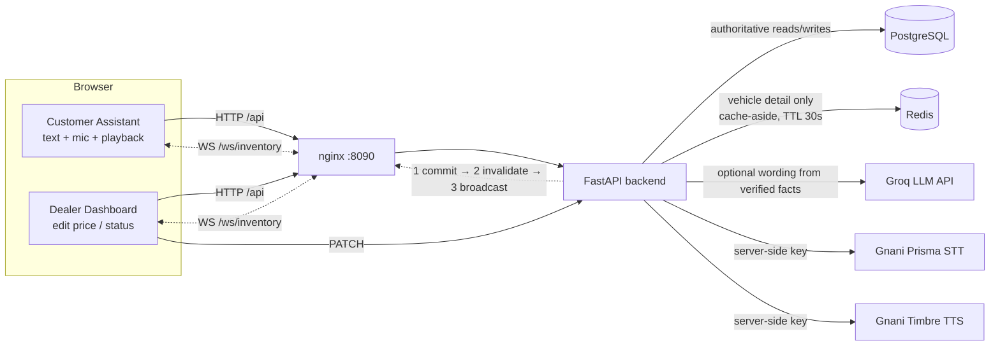

# AutoSense AI

A real-time, **inventory-grounded** automotive sales assistant. Customers type or speak in English, Hindi or Hinglish; the assistant answers only from the live dealership database, and a dealer dashboard changes inventory in real time.

> Independent portfolio project. All 12 listings are **fictional demo data**. Not affiliated with, or endorsed by, any dealership, Spyne, Gnani or any other company. Voice uses the publicly documented Gnani Prisma (speech-to-text) and Timbre (text-to-speech) REST APIs with your own API key.

## Architecture



### Update flow (the Spyne demo)
1. Dealer marks a car **Sold** → `PATCH /api/vehicles/{id}`.
2. PostgreSQL transaction **commits** (version +1, `updated_at` set).
3. Redis key `vehicle:{id}` is **invalidated**.
4. A `inventory_changed` event is **broadcast** over WebSocket to every client.
5. Customer chats show "recommendations may be outdated" (old answers are never rewritten). The next question queries PostgreSQL directly, so the sold car is gone.

### Grounding rules
- Core parsing (budget, transmission, body type, fuel, model, intent, language) is **deterministic** (`backend/app/nlu.py`).
- Recommendation **cards are built from database rows**, never from model output.
- The Groq model (if a key is set and the API is reachable) only *words* a short intro from a facts JSON. Its output is **rejected** (and the rule-based answer used, labelled "Rule-based fallback") if it contains any number not in those facts or claims a booking.
- Test-drive messages record a **request only**; nothing is ever "confirmed".
- Chat answers and filtered lists are never cached; availability-sensitive reads always hit PostgreSQL.

## Run it

Prerequisites: Docker Desktop. Optional: a free Groq API key (AI wording) and a Gnani API key (voice).

```bash
cp .env.example .env          # add GNANI_API_KEY to enable voice (optional)
docker compose up -d --build
```

- Customer assistant: http://localhost:8090/#/assistant
- Dealer dashboard: http://localhost:8090/#/dealer (open in a second window)
- API docs: http://localhost:8000/docs

All ports bind to `127.0.0.1` only. Without `GROQ_API_KEY` (or if Groq is down or rate-limited), chat still works with the labelled rule-based fallback.

### Develop without Docker for the app
```bash
docker compose up -d db redis                       # data stores only
cd backend && python -m venv .venv && .venv/Scripts/pip install -r requirements.txt
.venv/Scripts/python -m uvicorn app.main:get_app --factory --reload   # :8000
cd ../frontend && npm install && npm run dev                          # :5173 (proxies /api, /ws)
```

### Tests
```bash
cd backend && .venv/Scripts/python -m pytest -q    # SQLite + fake Redis + mocked Groq/Gnani
cd frontend && npm run build                       # type-check + production build
python scripts/demo_check.py                       # end-to-end sold-car demo against the running stack
```
Covered: seed, persistence across restart, SUV/automatic/budget filtering (English, Hinglish, Hindi), sold-car exclusion, price changes, invalid-update rejection, Redis hit/miss/invalidation, Redis outage fallback, WebSocket events and origin check, AI service unavailable/disabled/rate-limited and hallucination rejection, no fabricated prices or IDs, CORS, admin token, Gnani request formats with mocked responses. A **live Gnani smoke test** (`test_live_gnani_tts_then_stt_roundtrip`) runs only when `GNANI_API_KEY` is set in the environment.

## API
| Method | Path | Notes |
|---|---|---|
| GET | `/api/health` | DB, Redis, voice-configured flags |
| GET | `/api/vehicles` | `q`, `status`, `type` filters; counts; always from PostgreSQL |
| GET | `/api/vehicles/{id}` | cache-aside; `X-Cache: HIT/MISS/BYPASS` |
| PATCH | `/api/vehicles/{id}` | `price_inr` (>0) and/or `status` (`available`/`sold`), optional `expected_version`; `X-Admin-Token` if `ADMIN_TOKEN` set |
| POST | `/api/chat` | `{message, last_vehicle_ids}` → reply, cards, `source` (`llm`/`fallback`), `fallback_reason` |
| GET | `/api/diagnostics` | real cache counters, event log, client count |
| POST | `/api/voice/transcribe` | multipart `audio` (WAV) → Gnani Prisma |
| POST | `/api/voice/synthesize` | `{text, language}` → audio via Gnani Timbre |
| WS | `/ws/inventory` | `inventory_changed` events |

## Gnani integration
Implemented from the official docs (docs.gnani.ai): STT `POST https://api.vachana.ai/stt/v3` (multipart `audio_file`, `model=prisma-v3.0`, `language_code=hi-IN,en-IN`, header `X-API-Key-ID`); TTS `POST https://api.vachana.ai/api/v1/tts/inference` (JSON `text, voice, model, language, speed, audio_config`; raw WAV response). The browser records **16 kHz mono WAV** itself (Prisma lists WAV/MP3/OGG/FLAC/AAC/M4A, not the WebM that `MediaRecorder` produces) and is capped at 28 s (API limit is 30 s). The key stays server-side; without it the UI shows "Voice setup required" and text chat is unaffected. Hindi/English availability, voices and model access depend on your Gnani account. Browser speech APIs are never substituted. Telephony is out of scope.

## Known races and production improvements
- **Stale cache refill:** a reader can load the old row, then the writer commits + invalidates, then the reader writes the old value to Redis, which serves stale detail for up to the TTL (30 s). Mitigation here: short TTL, and availability-sensitive paths (chat, lists) never use the cache. Production: store `version` in the value and set via compare-and-set (Lua), or delete again after a short delay ("double delete").
- **Lost event:** the process can crash after the commit but before the broadcast. Production: a **transactional outbox** table written in the same transaction and drained by a relay to Redis Pub/Sub/Streams; clients also refetch on reconnect (implemented).
- **Single instance:** the WebSocket hub and cache counters are in-process. Use Redis Pub/Sub fan-out and Redis-backed counters for multiple replicas.
- **Concurrent edits:** the API supports `expected_version` (409 on mismatch); the UI doesn't send it yet, so last write wins.
- **Auth:** the dashboard is protected by localhost binding and an optional shared `ADMIN_TOKEN`, not real authentication. Add SSO/RBAC before exposing it.
- Blocking SQLAlchemy calls run inline in async handlers (fine for a demo; use the async driver or a threadpool at scale). Schema is created with `create_all`; use Alembic migrations in production.

## Behind a corporate TLS-inspecting proxy (e.g. Zscaler)
Outbound HTTPS to Gnani can fail with `CERTIFICATE_VERIFY_FAILED` / "Could not reach Gnani speech service" because the proxy re-signs traffic with a root CA that Python doesn't trust. Verification is **not** disabled; trust the proxy CA instead (note that your network's proxy can then inspect that traffic):
```powershell
powershell scripts/export_corp_ca.ps1            # exports the proxy root CA to certs/corp-root.pem
backend/.venv/Scripts/python -c "import certifi,pathlib;r=pathlib.Path('certs');(r/'ca-bundle.pem').write_text(pathlib.Path(certifi.where()).read_text()+'\n'+(r/'corp-root.pem').read_text())"
docker compose -f docker-compose.yml -f docker-compose.corp-ca.yml up -d
```
Local Python picks up `certs/ca-bundle.pem` automatically. `certs/` is git-ignored.

## Live voice check
```bash
backend/.venv/Scripts/python scripts/voice_check.py   # Timbre TTS -> Prisma STT -> chat, real Gnani calls
```

## Troubleshooting
- **Port in use:** the frontend uses 8090 (8080 is commonly taken). Change the mapping in `docker-compose.yml` and `CORS_ORIGINS`.
- **"Rule-based fallback · AI service ...":** set `GROQ_API_KEY` in `.env` (free key from console.groq.com), or ignore it: answers stay accurate, only the wording is plainer. A 429 means the free-tier rate limit; the app falls back automatically. Model ids change, so set `LLM_MODEL` to a current one from the Groq console if needed.
- **"Voice setup required":** set `GNANI_API_KEY` in `.env`, then `docker compose up -d`.
- **Mic blocked:** browsers allow the microphone only on `localhost`/HTTPS.
- **Reset data:** `docker compose down -v` (removes the Postgres volume; reseeds on next start). Edits otherwise persist across restarts.
- **Redis down:** the app keeps working from PostgreSQL; the Dealer screen shows "unavailable – using PostgreSQL".
